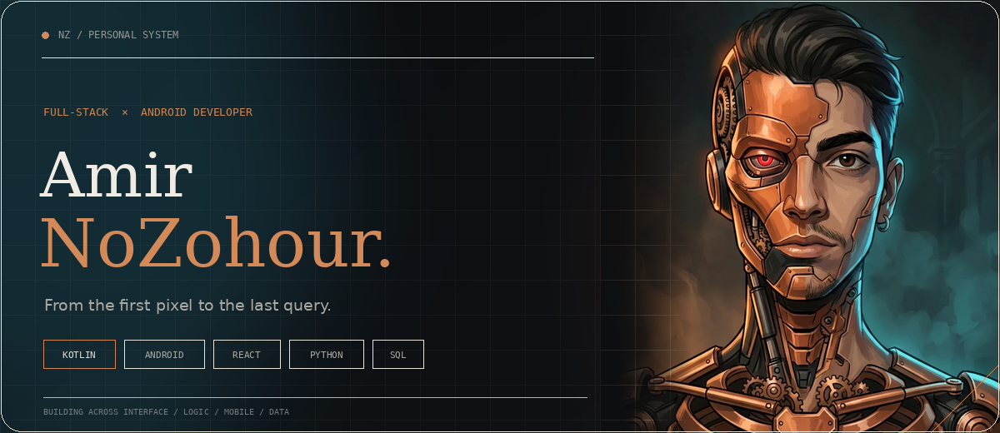

<div align="center">
  <a href="https://nzbozorg.ir">
    
  </a>
</div>

<br />

<div align="center">
  <a href="https://nzbozorg.ir"></a>
  <a href="https://t.me/nzornot"></a>
  <a href="https://instagram.com/nzbozorg"></a>
</div>

<br />

```text
┌─ NZ / IDENTITY ───────────────────────────────────────────────────────┐
│                                                                      │
│  Hey, I'm Amir NoZohour.                                             │
│  Full-stack developer × Android developer                            │
│                                                                      │
│  I connect what people see with what makes it work —                 │
│  from expressive interfaces and native mobile experiences           │
│  to application logic and the data underneath.                       │
│                                                                      │
└──────────────────────────────────────────────────────────────────────┘
```

## `01 / Behind the code`

I’m a developer who likes owning the **whole story** of a product.

The interface matters. So do the interactions, the architecture, and the quiet logic behind every tap. I build for the web with **HTML, CSS, JavaScript, and React**, create native Android experiences with **Kotlin**, and work with **Python and SQL** on the systems underneath.

> **I don’t want to make things that only work. I want them to leave a trace.**

<br />

## `02 / Development palette`

<table>
  <tr>
    <td width="25%" valign="top">
      <h3>◈ Structure</h3>
      <p>Semantic foundations, responsive layouts, and visual detail.</p>
      <code>HTML</code> <code>CSS</code>
    </td>
    <td width="25%" valign="top">
      <h3>◈ Interface</h3>
      <p>Fluid interactions and maintainable component systems.</p>
      <code>JavaScript</code> <code>React</code>
    </td>
    <td width="25%" valign="top">
      <h3>◈ Mobile</h3>
      <p>Native Android apps with thoughtful mobile experiences.</p>
      <code>Kotlin</code> <code>Android</code>
    </td>
    <td width="25%" valign="top">
      <h3>◈ Systems</h3>
      <p>Application logic, automation, and organized data.</p>
      <code>Python</code> <code>SQL</code>
    </td>
  </tr>
</table>

<br />

<div align="center">
  
  
  
  
  
  
  
  
</div>

<br />

## `03 / How I think`

```text
                THE PART YOU SEE                 THE PART THAT POWERS IT

              ┌──────────────────┐              ┌──────────────────┐
              │ UI / INTERACTION │              │ LOGIC / DATA     │
              │ HTML · CSS       │              │ Python · SQL     │
              │ React · Android  │      ⇄       │ APIs · Systems   │
              └──────────────────┘              └──────────────────┘

                         One developer. Every layer.
```

- **Clarity before decoration** — every detail should have a reason.
- **Motion with restraint** — interaction should guide, not distract.
- **Mobile is a first-class experience** — never a compressed desktop layout.
- **Code should age well** — understandable, maintainable, and intentional.

<br />

## `04 / Signal`

<div align="center">
  
  
</div>

<br />

## `05 / Open channel`

Have a project, an idea, or something interesting to share?

<table>
  <tr>
    <td><strong>Portfolio</strong></td>
    <td><a href="https://nzbozorg.ir">nzbozorg.ir ↗</a></td>
  </tr>
  <tr>
    <td><strong>Telegram</strong></td>
    <td><a href="https://t.me/nzornot">@nzornot ↗</a></td>
  </tr>
  <tr>
    <td><strong>Instagram</strong></td>
    <td><a href="https://instagram.com/nzbozorg">@nzbozorg ↗</a></td>
  </tr>
  <tr>
    <td><strong>Support</strong></td>
    <td><a href="https://coffeebede.com/Amir_NoZohour">Buy me a coffee ↗</a></td>
  </tr>
</table>

<br />

<div align="center">
  <sub>PIXELS&nbsp;&nbsp;◆&nbsp;&nbsp;LOGIC&nbsp;&nbsp;◆&nbsp;&nbsp;MOBILE&nbsp;&nbsp;◆&nbsp;&nbsp;DATA</sub>
  <br /><br />
  <strong>Built by Amir NoZohour.</strong>
</div>
